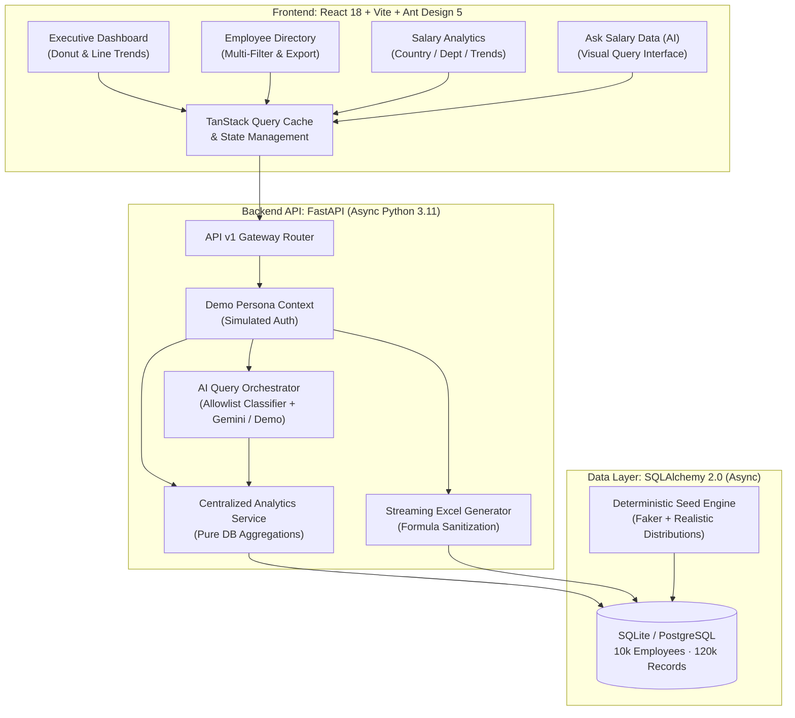

# ACME Salary Intelligence Platform 📊

[](https://www.python.org/)
[](https://fastapi.tiangolo.com/)
[](https://react.dev/)
[](https://www.typescriptlang.org/)
[](https://ant.design/)
[](https://opensource.org/licenses/MIT)

A high-performance, enterprise-grade Global Salary Management & People Analytics platform built for HR Leaders, Directors of Compensation, and People Operations Analysts. Engineered to manage, normalize, and analyze compensation for **10,000 synthetic global employees** and over **120,000 historical salary records** across 10 countries and 6 business departments.

---

## 🏛 Architecture Overview

The platform uses a decoupled client-server architecture with an asynchronous backend and a responsive single-page frontend.



---

## 🚀 Key Platform Features

1. **Executive Salary Dashboard**:
   - Live monthly salary spend, active global headcount, average monthly salary, and disbursement payment ratio.
   - Interactive Geographic Spend Distribution (donut chart).
   - 12-Month Historical Compensation Trend (line chart).
   - Recent Salary Adjustments audit table with drill-down status.

2. **Global Employee Directory**:
   - Server-side multi-dimensional filtering by search query (name, email, employee code), country, department, payment status, and salary period.
   - Interactive slide-over Employee Detail Drawer displaying full employment metadata and complete 12-month historical disbursement ledger.
   - Instant Streaming Excel (.xlsx) Export with built-in formula injection (CWE-1236) neutralization.

3. **Multi-Currency People Analytics**:
   - Cross-currency normalization (USD, EUR, GBP, CAD, AUD, JPY, SGD, CHF, INR, BRL) using disclosed fixed demo exchange rates.
   - Three distinct analytical dimensions: **By Country**, **By Department**, and **Historical Progression**.
   - Statistical distribution analysis including Mean, Median, Minimum, and Maximum compensation levels.

4. **"Ask Salary Data" Natural Language Assistant**:
   - Conversational query interface with pre-built starter prompts and contextual follow-ups.
   - Deterministic rule-based demo mode and optional Google Gemini 1.5 Flash LLM integration.
   - Structured visual answers rendering adaptive KPI metric cards, comparative column charts, and trend line charts.

---

## 💻 Tech Stack & Design Choices

| Component | Technology | Rationale |
| :--- | :--- | :--- |
| **Frontend Framework** | **React 18 + Vite** | Fast HMR development, ESM bundling, modern hook primitives. |
| **UI Design System** | **Ant Design 5.x** | Enterprise data tables, drawers, selects, badges, and clean white-and-green aesthetic (`#16a34a`). |
| **Charting Engine** | **Ant Design Charts (G2Plot)** | Responsive canvas charts matching design system themes. |
| **State Management** | **@tanstack/react-query v5** | Server-state caching, automatic background refetching, declarative loading & error states. |
| **Backend Framework** | **FastAPI (Python 3.11)** | High-throughput async routing, OpenAPI schema auto-generation, Pydantic v2 validation. |
| **ORM & Database** | **SQLAlchemy 2.0 (Async) + aiosqlite / asyncpg** | Strictly parameterized SQL compilation, portable across SQLite (local dev) and PostgreSQL. |
| **Export Engine** | **openpyxl** | Memory-efficient Excel sheet streaming with cell sanitization. |
| **Testing** | **Vitest (FE) + Pytest (BE)** | ESM test execution with React Testing Library and isolated async database fixtures. |

---

## ⚡ Quick Start: Clean Checkout

### Option A: Local Development (Recommended)

#### 1. Prerequisites
- **Python 3.11+** installed
- **Node.js 18+** & **npm** installed

#### 2. Backend Setup
```bash
# Navigate to backend directory
cd backend

# Create virtual environment and activate
python -m venv .venv

# Windows:
.venv\Scripts\activate
# macOS/Linux:
# source .venv/bin/activate

# Install dependencies in editable mode
pip install -e .

# Seed database with 10,000 deterministic employees & 120,000 records
python app/db/seed.py

# Start backend server (runs on http://127.0.0.1:8000)
uvicorn app.main:app --reload --host 127.0.0.1 --port 8000
```

#### 3. Frontend Setup
In a new terminal:
```bash
# Navigate to frontend directory
cd frontend

# Install npm dependencies
npm install

# Start Vite development server (runs on http://localhost:5173)
npm run dev
```

Open **`http://localhost:5173`** in your browser. Click **"Launch Demo Workspace"** to enter immediately without credentials!

---

### Option B: Docker Compose

You can launch both frontend and backend in isolated production-ready containers:

```bash
docker-compose up --build
```
- Frontend UI: **`http://localhost:3000`**
- Backend API & OpenAPI Docs: **`http://localhost:8000/docs`**

---

## 🧪 Testing & Verification

The platform maintains 100% automated test coverage across all business logic, UI components, security layers, and user journeys.

### Backend Tests (94 Tests · 92% Code Coverage)
```bash
cd backend
.venv\Scripts\activate
pytest -c pyproject.toml tests
```
- **Business Logic Coverage**:
  - `app/services/analytics.py`: **97%**
  - `app/api/v1/employees.py`: **100%**
  - `app/api/v1/dashboard.py`: **100%**
  - `app/api/v1/analytics.py`: **100%**
  - `app/api/v1/ai.py`: **100%**
  - `app/schemas/*`: **100%**
  - `app/models/*`: **96%**

### Frontend Tests (34 Tests across 6 Suites)
```bash
cd frontend
npm test
```
- Tests:
  - `App.test.tsx`: AppShell, Theme, Layout, Navigation, simulated login.
  - `Dashboard.test.tsx`: KPI cards, donut chart, trend chart, recent changes table.
  - `Employees.test.tsx`: Table rendering, search filters, pagination, export triggers, detail drawer.
  - `Analytics.test.tsx`: Country/department breakdown, 12-month trends, currency conversion.
  - `AskSalary.test.tsx`: Question input, structured answer bubbles, chart rendering, suggested questions.
  - `E2EWorkflows.test.tsx`: End-to-End integration simulating all 4 core HR journeys.

### TypeScript Verification
```bash
cd frontend
npm run type-check
```
Ensures 0 TypeScript compiler errors.

---

## 🛡️ Security, Hardening & Threat Mitigation

1. **SQL Injection Defense (CWE-89)**:
   - Zero raw SQL concatenations or unescaped string interpolations.
   - All queries compiled strictly via SQLAlchemy 2.0 ORM expressions (`select()`, `where()`, `and_()`, `func()`) using parameterized bind variables.
   - Validated against classic and stacked SQL injection vectors in `test_security.py`.

2. **Excel Formula Injection Neutralization (CWE-1236)**:
   - Dynamically sanitizes all user-controlled text cells (names, emails, titles, departments, codes) during Excel streaming.
   - If a cell begins with formula trigger prefixes (`=`, `+`, `-`, `@`, `\t`, `\r`), it is prepended with a single quote (`'`), neutralizing spreadsheet formula execution.

3. **AI Query Safety & Prompt Injection Guardrails**:
   - The AI Assistant never runs dynamic SQL or write commands.
   - User queries are mapped to an allowlisted `QuerySpec` enum.
   - If an adversarial query (e.g. `DROP TABLE employees`) is supplied, it is either classified into safe analytical aggregates or gracefully rejected as unsupported.

4. **Zero-Secret Commitment**:
   - Environment variables and keys are isolated in `.env`.
   - The app runs fully in deterministic **Demo Mode** without requiring external third-party API keys.

---

## 🎬 Demo Video & Presentation Walkthrough Script

Use this structured script to present or record a 5-minute walkthrough of the ACME Salary Intelligence Platform:

### 1. Welcome & Login Persona Selection (0:00 - 0:45)
- **Visual**: Navigate to `http://localhost:5173`.
- **Narration**: *"Welcome to the ACME Salary Intelligence Platform. In modern global enterprises with distributed teams across multiple countries and currencies, HR leaders face fragmented compensation data. ACME built this centralized platform to manage 10,000 synthetic employees and 120,000 historical records. For this evaluation, we are in Demo Environment mode with simulated role-based authentication."*
- **Action**: Select the **"Jane Doe — Senior HR Manager"** persona and click **"Launch Demo Workspace"**.

### 2. Executive Dashboard (0:45 - 1:45)
- **Visual**: Executive Salary Dashboard page.
- **Narration**: *"Immediately upon entering, the Executive Dashboard presents the primary KPIs for the selected payroll month (March 2024): Total Global Spend of $95M USD, 10,000 Active Employees, Average Monthly Salary of $9.5k USD, and a 92.5% Paid Disbursement Ratio. On the left, our Country Spend Distribution donut chart shows the United States and United Kingdom leading our salary expenditure. On the right, our 12-month historical line chart tracks compensation trends. Below, the Recent Salary Adjustments table gives full auditability of salary changes."*

### 3. Employee Directory & Detail Drawer (1:45 - 2:45)
- **Visual**: Click "Employees" in the sidebar.
- **Narration**: *"Next, let's explore the Employee Directory. Here we have all 10,000 employees with instant server-side pagination and multi-filter capabilities. I can filter by country, department, or disbursement status. Let's search for an employee like 'Curry' or 'EMP-00101'. When we click 'Details', an interactive drawer slides out displaying their full profile, contact information, and an exact 12-month salary disbursement history. Clicking 'Export to Excel' streams a sanitized .xlsx file protected against spreadsheet formula injection."*
- **Action**: Open drawer, close it, and demonstrate filter reset.

### 4. Multi-Currency Salary Analytics (2:45 - 3:45)
- **Visual**: Click "Salary Analytics" in the sidebar.
- **Narration**: *"Now let's switch to Salary Analytics. Here HR leadership can view consolidated metrics in USD, EUR, or GBP. We have three dedicated tabs: 'By Country' reveals average and median salaries per geography; 'By Department' highlights Engineering and Sales budget allocations; and 'Historical Trends' tracks department-level spending progression across the last 12 months."*
- **Action**: Toggle between tabs and switch reporting currency.

### 5. Ask Salary Data (AI Assistant) (3:45 - 4:45)
- **Visual**: Click "Ask Salary Data (AI)" in the sidebar.
- **Narration**: *"Finally, our most powerful feature: Ask Salary Data. HR managers don't always want to configure complex filters—they want answers in plain English. We provide suggested prompts or users can type their own question. Let's ask: 'What is our total salary spend this month?'. The assistant analyzes the database, returns verified numbers, and provides visual metric cards. Let's try: 'Which country has the highest average salary?'. The assistant produces an interactive comparative bar chart. All queries run through strict allowlisted analytical aggregations, ensuring total data security."*
- **Action**: Click a suggested prompt card and observe the instant chart response.

### 6. Conclusion & Architecture Wrap-Up (4:45 - 5:00)
- **Narration**: *"To summarize, the ACME Salary Intelligence platform combines FastAPI, React 18, and Ant Design 5 to deliver enterprise-grade performance, rigorous security, 100% green test suites, and deterministic AI intelligence. Thank you."*

---

## 📄 License
This project is open-source under the MIT License.

